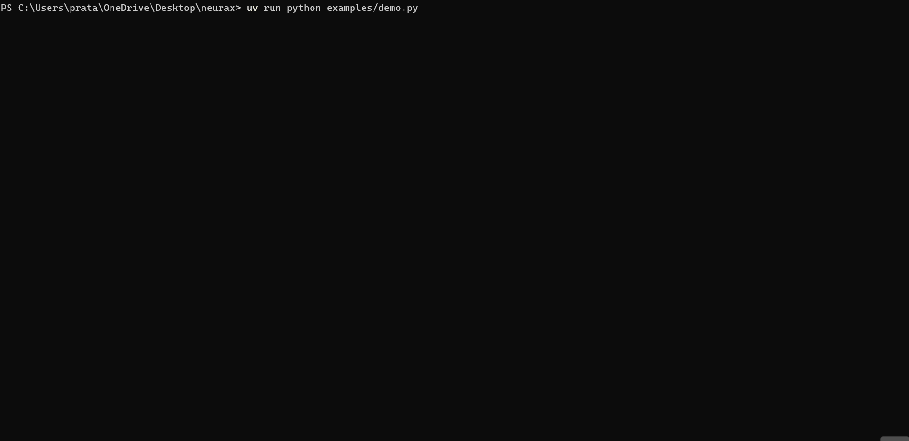

# Neurax

**Decision memory for AI coding agents.**

Coding agents forget everything between sessions, so we give them memory. But generic memory
stores flat facts: when you switch from Redis to Postgres, the agent remembers *both* and
happily follows the outdated one. Neurax never edits a decision: a change is a new memory
that **supersedes** the old one, so agents see the current decision by default and can still
ask how you got there.

Neurax is an [MCP](https://modelcontextprotocol.io) server. It works with Claude Code, Cursor,
Claude Desktop and any other MCP client. It is open source (Apache-2.0) and local-first: Postgres
in Docker plus a small local embedding model, with no API keys and no paid calls.

<!-- Demo GIF: record `uv run python examples/demo.py` and save it as docs/demo.gif -->
<!--  -->

## Before / after

Monday the agent decides *"Use Redis as the main datastore"*. Two weeks later you move to
Postgres, and the agent saves *"Use Postgres + pgvector as the main datastore"*. A new
session asks: *"what's our main datastore?"*

**Flat memory** returns both, both presented as true:

```
- Use Redis as the main datastore
- Use Postgres + pgvector as the main datastore
```

The agent picks one. Sometimes it writes Redis code.

**Neurax.** When the Postgres decision was saved, Neurax returned the Redis one under
`possible_conflicts`, and the agent called `supersede`. Search now returns only:

```
- [active] Use Postgres + pgvector as the main datastore
```

And `decision_history("database")` still shows the full story:

```
superseded  Use Redis as the main datastore
active      Use Postgres + pgvector as the main datastore   (one datastore for rows and vectors)
```

Run it yourself: `uv run python examples/demo.py` plays out Redis → Postgres → MySQL through a
real MCP client and prints both views side by side.

## Results

A decision-drift benchmark: 20 hand-written projects whose decisions change over time, 100
questions whose answer is the *current* decision. Retrieval only, deterministic, no LLM calls.
Same Postgres, same search and same embeddings for every system; the only difference is
whether changes supersede. Numbers below are on the 10 **held-out** projects (the conflict
threshold was tuned on the other 10).

| System | Top-1 correct | Stale answer in top 3 (changed decisions) |
|---|---|---|
| **Neurax** | **76%** | **0%** |
| Neurax, agent supersedes only what `possible_conflicts` shows | 76% | 3% |
| Flat memory | 54% | 82% |
| Flat memory + recency re-sort | 32% | 55% |

Full method, per-category numbers and the threshold sweep: [bench/RESULTS.md](bench/RESULTS.md).
Reproduce with `uv run python -m bench.run`.

## Install (5 minutes)

Needs [Docker](https://docs.docker.com/get-docker/) (running) and
[uv](https://docs.astral.sh/uv/getting-started/installation/).

```bash
git clone https://github.com/OWNER/neurax-mcp.git
cd neurax-mcp
scripts/install.sh you@example.com          # macOS / Linux / Git Bash
```

```powershell
scripts\install.ps1 -Email you@example.com  # Windows PowerShell
```

The script checks Docker and uv, starts Postgres (`docker compose up -d`), applies the
migrations, downloads the embedding model (about 70 MB, once) and prints the exact command to
connect Claude Code. The email is your identity in Neurax; all your projects belong to it. It
defaults to `git config user.email`.

<details>
<summary>Manual steps</summary>

```bash
uv sync
docker compose up -d --wait
uv run neurax-migrate
uv run python -m neurax.health        # OK: connected / OK: vector extension installed
uv run python -c "from neurax import embeddings; embeddings.embed(['warmup'])"
```

</details>

Neurax runs from the clone for now; there is no `pip install` yet. Keep Docker running
(`docker compose up -d` after a reboot), since the server needs Postgres.

## Connect your agent

In every example, replace the email and `/path/to/neurax-mcp` with your own (the install
script prints both).

**Claude Code**, once for all your projects:

```bash
claude mcp add --scope user --env NEURAX_USER_EMAIL=you@example.com --transport stdio neurax -- uv --directory /path/to/neurax-mcp run neurax-server
```

Check with `claude mcp list`. Remove with `claude mcp remove neurax --scope user`.

**Cursor**: `.cursor/mcp.json` in your project (or `~/.cursor/mcp.json` for all projects):

```json
{
  "mcpServers": {
    "neurax": {
      "command": "uv",
      "args": ["--directory", "/path/to/neurax-mcp", "run", "neurax-server"],
      "env": { "NEURAX_USER_EMAIL": "you@example.com" }
    }
  }
}
```

**Claude Desktop**: `claude_desktop_config.json` (Settings → Developer → Edit Config;
`%APPDATA%\Claude\` on Windows, `~/Library/Application Support/Claude/` on macOS):

```json
{
  "mcpServers": {
    "neurax": {
      "command": "uv",
      "args": ["--directory", "/path/to/neurax-mcp", "run", "neurax-server"],
      "env": { "NEURAX_USER_EMAIL": "you@example.com" }
    }
  }
}
```

If Claude Desktop can't find `uv`, use its full path (`which uv` / `where uv`). On Windows,
write paths in JSON with forward slashes or doubled backslashes. To use a database other than
the Docker one, add `DATABASE_URL` to `env`.

### Tell your agent to use it

Paste this into your project's `CLAUDE.md` (or `.cursorrules`, `AGENTS.md`) and set the slug:

```markdown
## Project memory (Neurax)

This project's decisions live in Neurax under the project slug `my-project`.

- **Start of every session:** call `get_project_context("my-project")` and treat the result
  as the current state of the project. If the project doesn't exist, call `list_projects`,
  then `create_project` if needed.
- **During work:** when a past decision matters, call `search_context` before assuming.
- **End of every session:** call `save_context` once per decision, constraint, fact or task
  that came up. One statement per call, with a rationale for decisions, a short topic
  (e.g. `database`, `auth/session-store`) and `source_tool: "claude-code"`.
- **After each save:** review `possible_conflicts`. If the new memory replaces one of them,
  call `supersede(old_id, new_id)`. Never re-save an old decision to "update" it.
```

## How it works

**Memories.** Each memory is one statement: a `decision`, `constraint`, `fact` or `task`, with
a topic (`database`, `auth/session-store`) and an optional rationale. Content is immutable;
the database rejects edits.

**Supersede.** A change is a new memory plus `supersede(old_id, new_id)`. The old memory
becomes `superseded`: hidden from normal search and context, kept in history. History is a
straight line: each memory is replaced at most once, never revived, and only within its own
project. These rules are enforced by Postgres constraints and triggers, not just by the code.

**Conflicts.** Neurax doesn't decide what replaces what; your agent does. Every `save_context`
returns `possible_conflicts`: other current memories on the same topic, or with embedding
similarity ≥ 0.74 (chosen by the benchmark's threshold sweep). The agent reads them and calls
`supersede` where the new memory replaces one.

**Ranking.** `search_context` is one SQL query over current memories:

```
score = 0.55 · vector similarity   (local BAAI/bge-small-en-v1.5)
      + 0.25 · full-text rank      (Postgres ts_rank_cd)
      + 0.10 · recency             (half-life 30 days)
      + 0.10 · pinned
```

Candidates are the top 50 by vector plus the top 50 by keyword. With `include_history=true`,
replaced memories are included with a score penalty, so current ones still rank first.

| Tool | When agents call it |
|---|---|
| `get_project_context` | Start of a session: pinned items, current constraints and decisions, open tasks |
| `save_context` | End of a session, once per item; returns `possible_conflicts` |
| `supersede` | When a new memory replaces an old one |
| `search_context` | During work, to find a past decision (`include_history` for replaced ones) |
| `decision_history` | "How did we end up here?" for a topic |
| `pin` / `unpin` | Keep a few memories at the top of every session's context |
| `list_projects` / `create_project` | Find or create the project slug |

Details, invariants and configuration: [docs/ARCHITECTURE.md](docs/ARCHITECTURE.md).

## Limitations

Honest numbers from the held-out benchmark and from using Neurax on itself:

- **Changes saved under a new topic are the weak spot.** When the replacement is filed under a
  different topic than the original, top-1 accuracy is 65%, against 83% when every version
  shares a topic. Reusing the old memory's topic matters.
- **The agent can miss a replacement.** An agent that only supersedes what `possible_conflicts`
  shows misses about 3% of replacements (conflict recall 0.97), and that outdated decision
  stays current.
- **Supersession depends on the agent.** Neurax surfaces candidates; the calling model has to
  follow the instructions and call `supersede`. Nothing is extracted or resolved automatically.
- **No "done" status for tasks yet.** A finished task can only be superseded, so open tasks
  accumulate in `get_project_context`.
- **Local and single-user for now.** One user per install (`NEURAX_USER_EMAIL`), stdio transport,
  runs from a git clone.

## Roadmap

Not in v1. Built after launch if users ask for it (from [PARKING_LOT.md](PARKING_LOT.md)):

- Task done/closed status
- Hosted team version: shared projects, auth, row-level security
- Web UI to browse and edit memory
- Audit log of every save, supersede and pin
- Automatic contradiction resolution instead of leaving it to the calling model
- Knowledge extraction from documents, repos and chat exports
- Graph retrieval, context composition and compression for long histories
- Public REST API and SDK; IDE and browser integrations

## Development

```bash
uv run pytest                                   # integration tests (real Postgres, neurax_test)
uv run ruff check && uv run ruff format --check && uv run mypy src tests examples
```

See [CONTRIBUTING.md](CONTRIBUTING.md). Licensed under [Apache-2.0](LICENSE).
